# FlippeFloppe
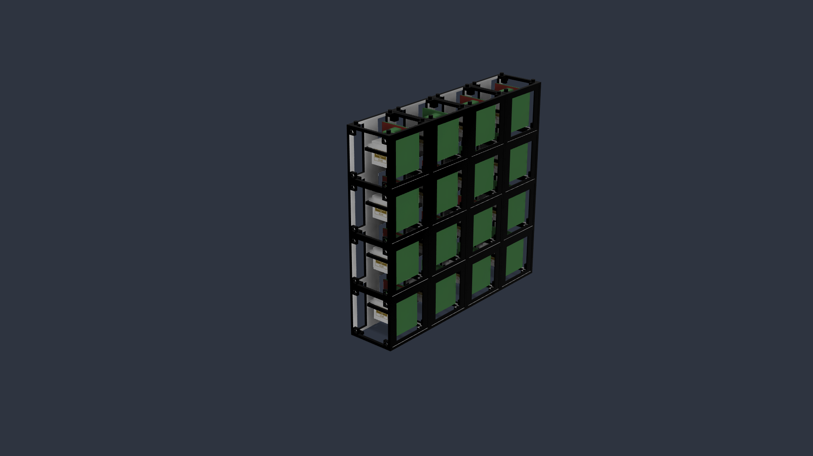

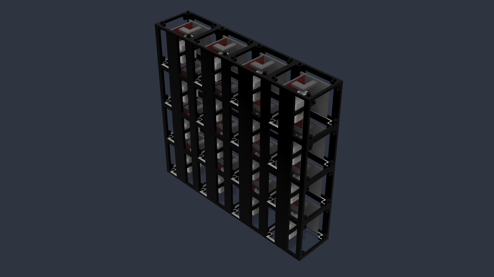

**FlippeFloppe is a modular mechanical display.**

Each pixel has an L shape being flipped (rotated) by a SG90 servo.

It can be used to display things like animations and text depending on the size of the grid.

This prototype uses 16 modules in a 4x4 grid and uses it as a 24h binary clock.

 (I had to save $ on filament so binary clock felt like the best idea for a 4x4 grid.)

Also it doesn't require a PCB.

## Example

The animation shows the time going from 9:57 am to 10:00 am :

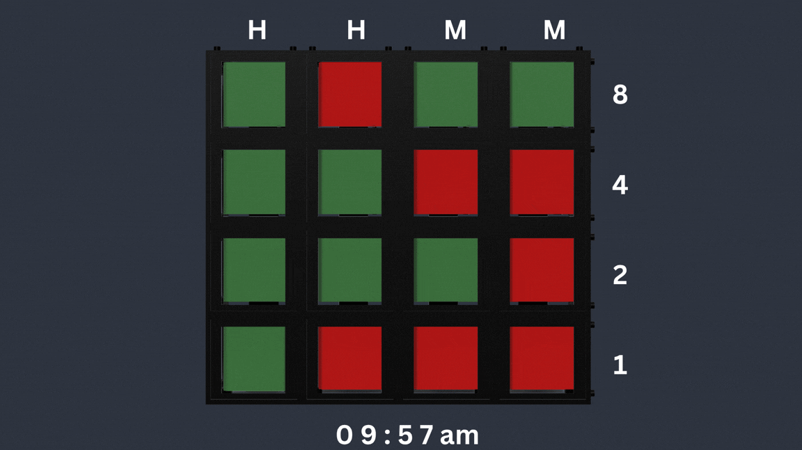

The maximum number of pixels ON (red) in this 24-hour binary clock is 9, first reached at 17:37 and again at 17:57.

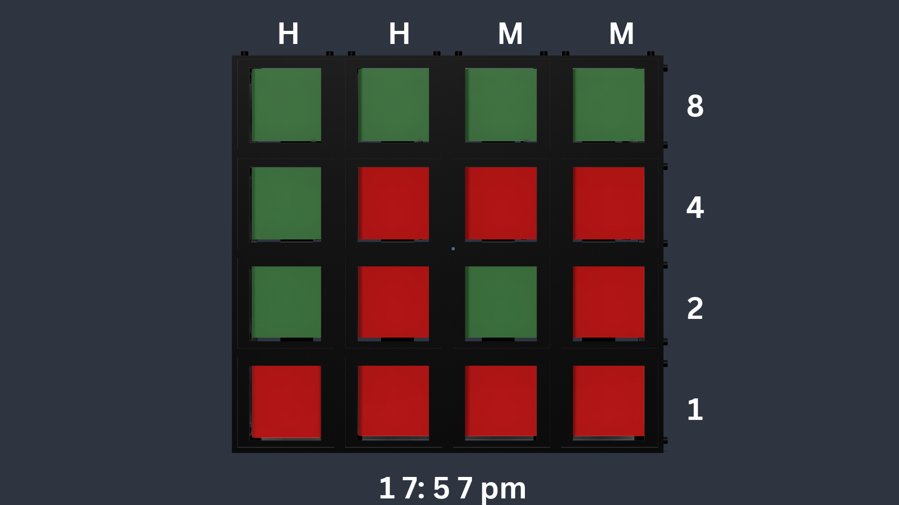

## Status
Currently only CAD model is designed and not printed physically. Print settings probably will change.

Code is tested with XIAO S3 and only 4 SG90 servos.

## Why I made it

First time I saw a mechanical display was in a YouTube video which showed Split-Flap displays. It looked very cool and satisfying and I really wanted to make it, but felt way too complex. I searched around for easier designs but then just gave up, until I came across a video titled "[Mechanically Multiplexed Flip-Dot Matrix](<https://www.youtube.com/watch?v=tzm8KB9QgJg>)" by James Bruton. His mechanism was really simple but it was slow as it only used 3 servos for the entire display which used a motor and a lead screw to move them left and right. So I decided to take inspiration from his design and make my own mechanical display which uses one servo per pixel.

I probably would have procrastinated this project if it wasn't for hackclub's Half Life event.

## How it works

**There are 3 parts per module.**

1) Pixel
2) Servo
3) Enclosure

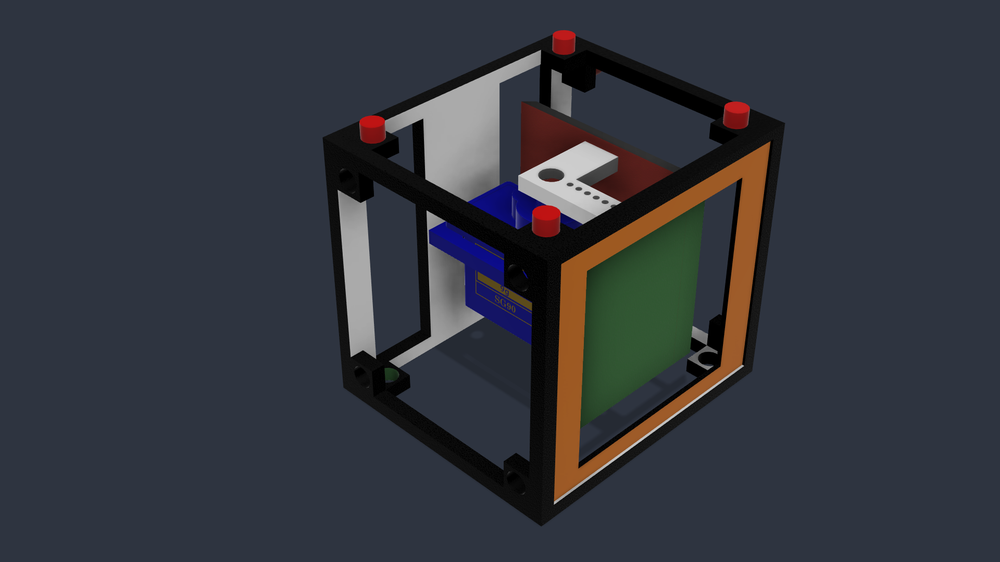
(the orange color frame is just for demonstration only, the color will be black when printed)

Each pixel has two squares joined together in a L shape. A servo rotates the pixel from center.
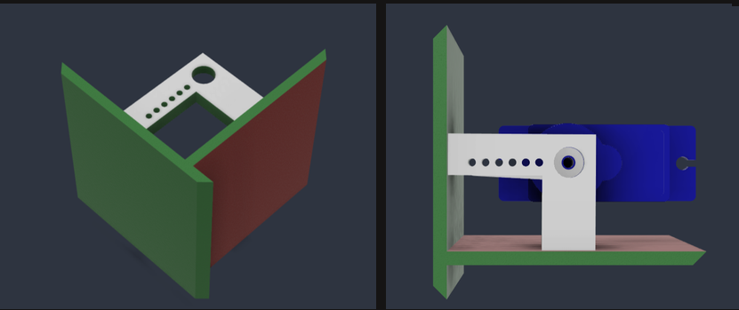

I used only 2 faces because if I had gone with more, the diameter in which the pixel spins would become too large and would make the grid spacing bigger as well, meaning two pixels would have to sit further apart from each other.

The red square sits at a lower height than the green square, along with both square's edges being chamfered, so it saves even more space.

(**Green** = OFF // **Red** = ON)
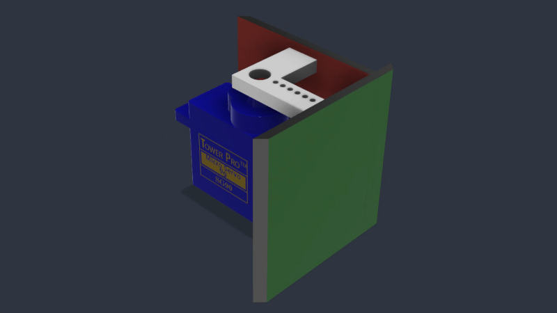

## File structure
- `CAD` folder contains `.stl` , `.step`  and  `.f3z` file.
- `Firmware` folder contains code for the whole display. It also contains KiCad files for the schematic. PCB is not needed.
- `Images` folder contains images for readme.

## How to print

`part1` stl - needs to be printed 16 times.
`part2` stl - needs to be printed 16 times.
- Material: PLA 
- Color: White
- Layer height: 0.2mm
- Supports: YES
- Infill: any

Use this rotation when putting parts in slicer so it uses less supports
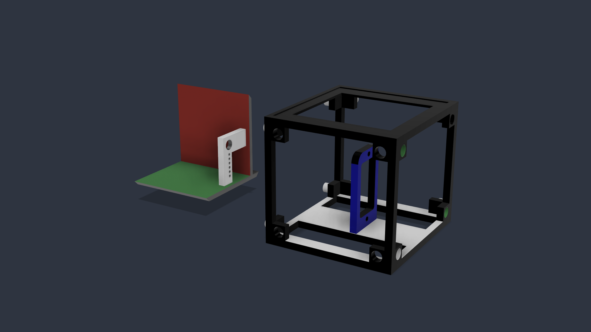

As the walls are thin for enclosure as well as the L shape, infill doesn't really matter. 

But as both the parts are print-in-place, there is a need for lots of supports.

I have not printed the parts yet so the settings are not tested.

## How to connect
### Parts needed
Overall 
- (1x) ESP32 C3 SuperMini
- (1x) PCA9685 (one of these per (16x) servos)
- (1x) 5V / 5A power supply (depends on how many servos are present)

Per module
- (2x) 3d printed parts
- (1x) servo
- (3x) screws (2 for mounting servo on and one for screwing the L shape onto servo horn.)

In this mechanical display, screws are not required for connecting the enclosures with each other. The enclosure is the same model printed 16 times. The modules have pegs and holes on all 6 of their faces.

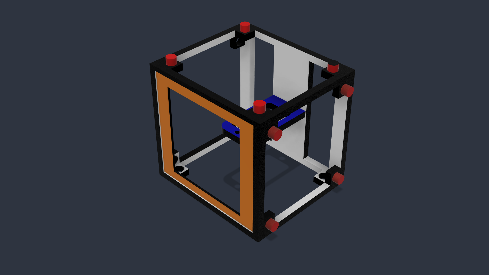
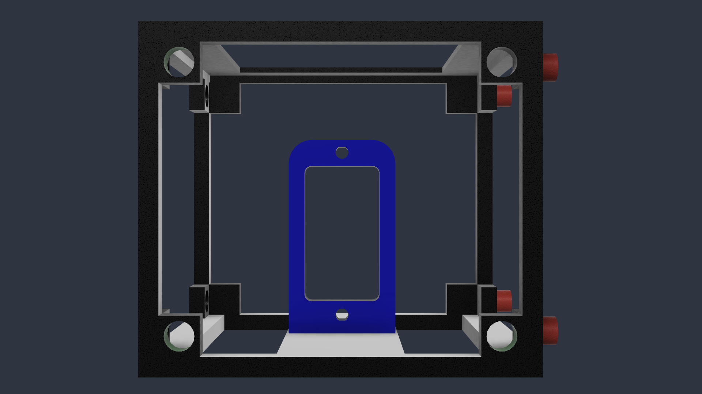

The modules just slide on together with each other. The holes and pegs are mainly for alignment. No screws are required for connecting modules together.

Though the servo does need screws for its mount.
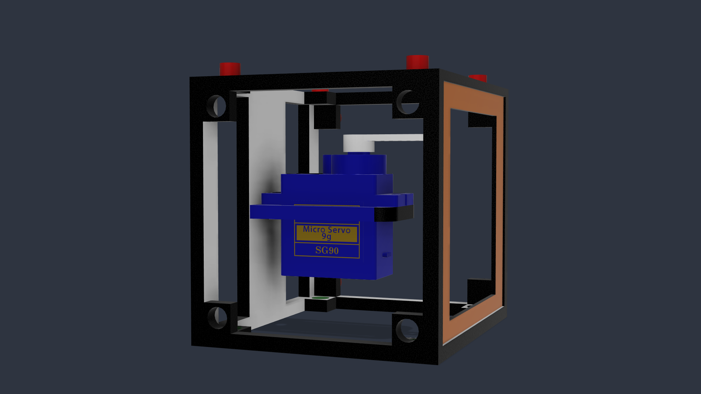

## Schematic / Wiring diagram
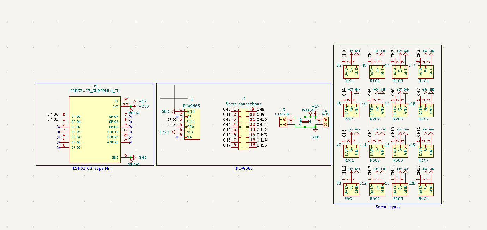

No PCB required as its just 3 components which connected together with a few jumper wires.

## Firmware
// WIP //

!! The current .ino file is tested with 4 servos and a xiao s3 !!

`Firmware` folder contains a `display.ino` file. This is the code for ESP32.

It also contains a wiring schematic which is very simple. You only need to connect the ESP32 and PCA9685 using 4 wires.

I've used a ESP32 C3 SuperMini as its very small and cheap. We only need 2 GPIO pins for I2C anyways so we have more than enough pins. Only GPIO0 and GPIO1 are used on the C3.

## BOM
Bom · MD
| Sr | Component | Use | Qty | $ (each) | Link |
|----|-----------|-----|-----|----------|------|
| 1 | ESP32 C3 SuperMini | Microcontroller | 1 | 2.72 | [Link](https://makerbazar.in/products/esp32-c3-supermini-iot-development-board) |
| 2 | PCA9685 | Driving the servos | 1 | 2.62 | [Link](https://robu.in/product/16-channel-12-bit-pwmservo-driver-i2c-interface-pca9685-arduino-raspberry-pi/) |
| 3 | SG90 Servo | Driving the mechanism | 16 | 0.94 | [Link](https://robu.in/product/towerpro-sg90-9g-mini-servo-9-gram/) |
| 4 | Power supply | 5V / 5A supply | 1 | 4.50 | [Link](https://quartzcomponents.com/products/5v-5a-power-supply-charger-25w-smps-adapter) |
 

## To-do list
1) Make enclosure for electronics
2) Add OLED screens on the bottom so normal clock can be read on the oleds.
Here's my design for the oled enclosure:
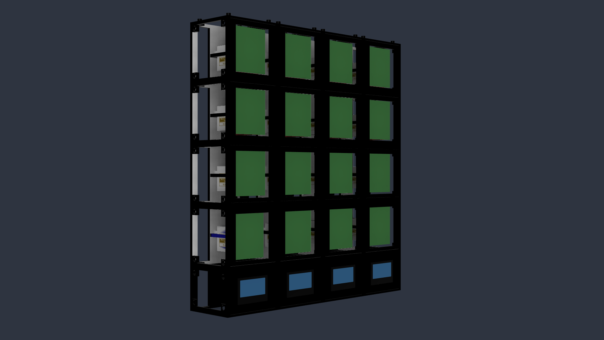
3) Change code to be for ESP32 C3 SuperMini
3) Add RTC module so binary clock works offline. (basically adding this once week 9 starts)
