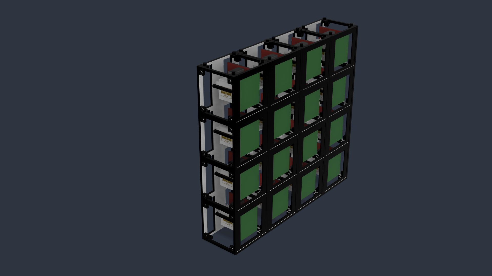
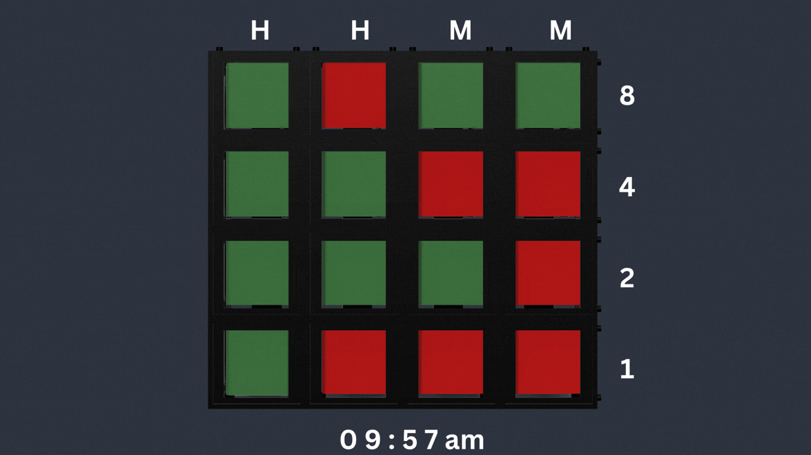

# FlippeFloppe

FlippeFloppe is a modular mechanical display.

It can be of any size, but each module requires one SG90 servo.

It can be used to display things like animations and text depending upon the size of the grid. 

For this prototype though, I'll be using a 4x4 grid and use it as a binary clock.

Here are a few examples:

In this, the display shows time from 9:57am to 10am. Green square is OFF while red square is ON.
